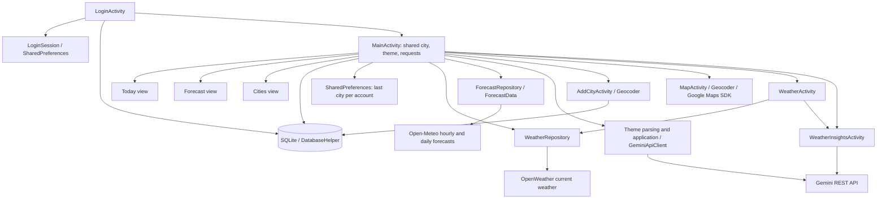

# WeatherLens

WeatherLens is a native Android weather app built with **Java and XML layouts**. It combines saved cities, live current weather, seven-day forecasts, interactive maps, and Gemini-powered weather insights and personalized themes.

The interface uses a warm cream background, large white rounded cards, pink accents, friendly weather illustrations, and high-contrast input states.

## Features

| Feature | Description |
| --- | --- |
| Local accounts | Sign up, sign in, and log out; successful sign-in is remembered across app restarts and updates until logout |
| Saved cities | Add, validate, and remove cities, with a separate list for each user |
| Today | View the selected city’s local time, temperature in Celsius, conditions, humidity, and wind |
| Forecast | Swipe through today’s hourly temperatures and compare seven daily forecasts |
| Interactive maps | Explore a selected city's location using Google Maps |
| AI weather insights | Generate questions and answers grounded in current weather data |
| Personalized themes | Describe a visual atmosphere and let Gemini generate structured theme colors |
| Default theme | Use built-in colors when theme generation fails |

## Main Navigation

After login, three persistent bottom tabs share one selected city and one user-level color theme:

| Tab | Purpose |
| --- | --- |
| **Today** | Current weather for the selected city, with a link to AI weather insights |
| **Forecast** | Horizontally scrolling hourly temperatures and seven daily forecasts with high/low range bars |
| **Cities** | Compare today’s temperatures for saved cities; add or remove cities with Undo |

Switch cities with the compact dropdown aligned to the right of the Today or Forecast heading. Both headings share the same selected city, and switching either updates weather, forecasts, and the map destination together. Forecast includes **Weather details** and **Map** actions. Refresh, city map, and logout actions are available from the top-right menu. First-time users without saved cities start in Cities.

```text
Login
└── WeatherLens
    ├── Today    → Current weather → AI weather insights
    ├── Forecast → Today’s hourly strip + seven-day daily outlook
    │             ├── Weather details
    │             └── Map
    └── Cities   → Today’s temperatures / add / remove a city
```

Today displays humidity and wind in two equal-width cards beneath current conditions. Cities presents its heading and temperature overview without an account-name subtitle.

All cities use the same layouts. AI customizes account-level colors; it does not generate city-specific layouts or forecast measurements.

Forecasts come from the [Open-Meteo Forecast API](https://open-meteo.com/en/docs), using the selected city's coordinates and `timezone=auto`. Forecast shows the remaining hours of today in a horizontal strip and seven days of daily high/low temperatures, weather conditions, maximum precipitation probability, and range bars sharing the week's temperature scale. Null or invalid precipitation probabilities display as unavailable. Current conditions still come from OpenWeather; the forecast requires no additional API key. Open-Meteo attribution is displayed below the forecast.

## Tech Stack

### Language and Platform

| Technology | Configuration and purpose |
| --- | --- |
| Java | Main application language; Java 17 source and target compatibility |
| Android SDK | Native Android application platform |
| Minimum SDK | API 29 — Android 10 |
| Compile SDK | API 32 |
| Target SDK | API 32 |
| Android Studio | Development, layout previews, builds, and emulator integration |
| JDK 17 | Pinned Gradle runtime, Java compiler, and local unit-test runtime |

### UI and Navigation

| Technology | Version | Purpose |
| --- | --- | --- |
| Android XML layouts | Platform API | Screen layouts and view hierarchies |
| AndroidX AppCompat | 1.3.0 | Compatible Activity base classes and UI components |
| Material Components | 1.4.0 | Text fields, floating labels, buttons, and other controls |
| ConstraintLayout | 2.0.4 | Constraint-based layouts |
| Activities and Intents | Platform API | Screen navigation and transfer of city, weather, and theme data |
| View Binding | Enabled in build configuration | Generated layout bindings; existing screens also use `findViewById` |
| AndroidX Navigation | 2.3.5 | Fragment and UI dependencies are declared; current navigation primarily uses Activities and Intents |
| Drawables, color state lists, and styles | Android resource system | Gradients, icons, typography, buttons, and input focus states |

### Storage, Networking, and Background Work

| Technology | Purpose |
| --- | --- |
| SQLite and `SQLiteOpenHelper` | Store users, saved cities, theme descriptions, and cached theme JSON |
| `SharedPreferences` | Remember the signed-in user and last selected city per account |
| SHA-256 and `MessageDigest` | Password hashing used by the current local account implementation |
| `HttpURLConnection` | Make direct HTTP requests to weather and Gemini APIs |
| `org.json` | Build and parse JSON; local unit tests declare version 20231013 |
| `ExecutorService` and `Executors` | Run network requests and other work on background threads |
| Android Handler and UI callbacks | Deliver background results to the main thread |
| `java.time` | Handle weather timestamps and city timezone offsets |

### External Services

| Service | Purpose | Configuration |
| --- | --- | --- |
| OpenWeather Current Weather API | Fetch live current conditions | `WEATHER_API_KEY` |
| Open-Meteo Forecast API | Fetch hourly and seven-day daily forecasts | No key |
| Google Maps SDK for Android 18.1.0 | Display city maps | `MAPS_API_KEY` |
| Android Geocoder | Validate cities and look up locations | Android system service |
| Gemini 2.5 Flash REST API | Generate theme colors and weather insights | `GEMINI_KEY` |

The Android client calls external APIs directly. There is no separate backend or cloud account synchronization. AI features use a hosted model API; the app does not train or run a model on the device.

### Build and Testing

| Technology | Version | Purpose |
| --- | --- | --- |
| Gradle Wrapper | 8.12.1 | Consistent project build tooling |
| Android Gradle Plugin | 8.1.1 | Android builds, resource processing, and APK packaging |
| Groovy Gradle DSL | — | Build configuration |
| Google Maven, Maven Central, and Gradle Plugin Portal | — | Dependency and plugin resolution |
| JUnit | 4.13.2 | Local unit testing |
| AndroidX Test JUnit | 1.1.3 | AndroidJUnit4 instrumentation support |
| AndroidX Test Core | 1.4.0 | Device testing utilities, including ActivityScenario |
| Espresso Core and Espresso Intents | 3.6.1 | UI actions, assertions, and navigation verification |
| UI Automator | 2.2.0 | Additional device UI automation support |

Versions listed above reflect the current repository's build configuration.

## Engineering Challenges

The core engineering challenge is coordinating Android lifecycle events, local persistence, and multiple asynchronous APIs while translating unpredictable AI output into a consistent, readable native interface with reliable fallback behavior.

## Project Structure

```text
WeatherLens/                         # Repository root; local folder name may differ
├── app/
│   ├── build.gradle                 # SDK, dependencies, API configuration, and packaging
│   └── src/
│       ├── main/
│       │   ├── AndroidManifest.xml
│       │   ├── java/edu/uiuc/weatherlens/
│       │   │   ├── *Activity.java    # Screens and interaction logic
│       │   │   ├── LoginSession.java # Remember the local sign-in
│       │   │   ├── CitySelectorAdapter.java # Shared city dropdown and themed popup
│       │   │   ├── DatabaseHelper.java
│       │   │   ├── WeatherRepository.java
│       │   │   ├── forecast/        # Forecast transport, parsing, and local-date grouping
│       │   │   ├── theme/           # Theme models, parsing, defaults, and application
│       │   │   └── weatherinsights/ # Gemini client, prompts, parsing, and callbacks
│       │   └── res/
│       │       ├── layout/          # Screen XML files
│       │       ├── values/          # Strings, themes, and shared styles
│       │       ├── color/           # Input state colors
│       │       └── drawable/        # Gradients and icons
│       ├── test/                    # Local unit tests
│       └── androidTest/             # Emulator and device tests
├── .java-version                    # Java 17 for compatible version managers
├── gradle/
│   ├── gradle-daemon-jvm.properties  # Gradle runtime pinned to Java 17
│   └── wrapper/                     # Gradle 8.12.1 distribution
├── build.gradle
├── settings.gradle
├── gradle.properties
├── local.properties.example
├── gradlew
└── README.md
```

The Gradle project lives directly at the repository root. No additional `Project/` directory is required.

## Architecture and Data Flow

WeatherLens is a single-module, Activity-based Android client. Activities own presentation state and coordinate repositories and local storage directly. The three home tabs are XML view trees inflated into one `MainActivity`, with visibility toggled when changing tabs. They do not have separate Activities, Fragments, or ViewModels.



### Screens and Responsibilities

| Component | Responsibility |
| --- | --- |
| `LoginActivity` / `LoginSession` | Validate local credentials, remember successful sign-in, restore valid sessions, and clear stale references to deleted accounts |
| `MainActivity` | Own the selected city and tab, inflate home pages, coordinate requests, render dynamic forecast/city cards, and apply the account theme |
| `CitySelectorAdapter` | Render the shared city selector and its themed popup; the same selector moves between Today and Forecast heading slots |
| `AddCityActivity` | Validate city names with Geocoder and save them for the active user |
| `WeatherActivity` | Standalone current-weather details, reached from Forecast; reuses `activity_weather.xml` with its own loading logic |
| `MapActivity` | Geocode the selected city and show a marker with Google Maps |
| `WeatherInsightsActivity` | Receive the city and current-weather JSON through Intent extras, generate suggested questions, and request an answer after selection |
| `ThemeSpec`, `ThemeParser`, `ThemeManager` | Validate structured colors and apply them to native views; retain the default palette when generation fails |

### Weather Request Flow

1. The launcher restores a valid local session or shows sign-in. `MainActivity` reads the user's saved cities, last city selection, and cached theme.
2. `WeatherRepository` requests OpenWeather current conditions for the selected city. Today renders the result; the same result also supplies a temperature snapshot for Cities.
3. When Forecast is visible, `MainActivity` extracts latitude and longitude from the current-weather JSON and calls `ForecastRepository`. Forecast therefore depends on a successful current-weather response even though Open-Meteo itself requires no API key.
4. `ForecastData` parses and sorts hourly slots and daily summaries using the location's IANA timezone returned by Open-Meteo. The view shows the current hour onward for today and seven daily rows. `TemperatureRangeView` draws each day's low/high range against the same weekly scale. Missing or invalid precipitation probabilities display as `—`.
5. Opening Cities loads current-weather snapshots for saved cities as needed. Snapshots stay in memory with a ten-minute reuse window. On resume, the selected city's current weather reloads when first opened or older than ten minutes; the menu's refresh action explicitly requests it again.

`MainActivity` uses a three-thread executor and dispatches UI updates to the main thread. Changing city cancels the previous current-weather and forecast tasks, clears their display state, and increments a request generation counter. Callbacks must still match that generation and a live Activity before updating views. Activity destruction shuts down the executor. Network failures show errors and retry actions; forecast requests use 20-second connect/read timeouts.

### Persistence and Restoration

| State | Storage and lifetime |
| --- | --- |
| Accounts, password hashes, saved cities, theme descriptions, generated theme JSON | SQLite through `DatabaseHelper`; local to this app installation |
| Signed-in username | App-private `login_session` preferences; survives process restarts and compatible app updates until logout |
| Last selected city | `weatherlens` preferences, keyed by username |
| Active tab, selected city, applied theme JSON | Activity saved-instance state for recreation; a fresh launch starts in Today, or Cities when no city is saved |
| Current conditions, forecasts, saved-city snapshots | Activity memory; fetched again after recreation/restart as needed |

The database retains the historical filename `cs427app.db` inside the new application's private storage. That filename does not determine the Android application ID. The current schema version is 3; the existing upgrade handler drops and recreates its tables rather than migrating account data.

### AI and Theme Boundaries

A valid cached account theme is reused. When a new description needs generation, the home screen remains usable with default colors while `GeminiApiClient` requests schema-constrained JSON in the background. Valid generated colors are persisted in SQLite and applied to the home shell, cards, navigation, and dropdown popup. AI changes colors, not layout structure or weather measurements.

`WeatherInsightsActivity` currently owns its question/answer network flow and exposes a test generator hook. The `weatherinsights/` package also contains repository, parser, prompt, and callback abstractions; these coexist with the Activity's implementation rather than forming a single repository layer for every Gemini call.

## Run Locally

### 1. Open the Project

```bash
git clone https://github.com/shuyangzhang-sde/WeatherLens.git
cd WeatherLens
```

Open the repository root in Android Studio and wait for Gradle sync. If you already have a local checkout, open that folder directly.

Install Android SDK Platform 32 and JDK 17. Use an emulator or device running Android 10 or later.

The project pins Java **17** in three places:

- `gradle/gradle-daemon-jvm.properties` selects JDK 17 for Gradle builds, including builds launched with a different `JAVA_HOME` or IDE JDK.
- `app/build.gradle` selects a Java 17 toolchain and Java 17 source/target compatibility for compilation and local JVM tests.
- `.java-version` declares Java 17 for version managers that support this file.

Any JDK 17 vendor and current security patch is allowed; the project does not pin a machine-specific installation path or an old patch release. Gradle must be able to discover an installed JDK 17; automatic JDK downloads are not configured. Use `./gradlew --version` to check the Daemon JVM and `./gradlew -q javaToolchains` to inspect detected JDKs. Always build with the checked-in Gradle Wrapper (`./gradlew` or `gradlew.bat`).

In Android Studio, use **Settings > Build, Execution, Deployment > Build Tools > Gradle** to select JDK 17 (or the project's Daemon JVM criteria on versions that support it), then sync the project. Android Studio itself can continue using its bundled runtime. On macOS, a terminal can select JDK 17 with `export JAVA_HOME=$(/usr/libexec/java_home -v 17)`.

### 2. Configure API Keys

Edit `local.properties` in the repository root. Android Studio normally writes `sdk.dir` automatically; retain that entry and add the keys required for your features:

```properties
WEATHER_API_KEY=your_openweather_key
GEMINI_KEY=your_gemini_key
MAPS_API_KEY=your_google_maps_key
```

Use `local.properties.example` as a guide. Enter raw values without surrounding quotes.

| Provider | Setup |
| --- | --- |
| [OpenWeather](https://home.openweathermap.org/api_keys) | Obtain a key for current weather |
| [Google AI Studio](https://aistudio.google.com/apikey) | Obtain a Gemini API key |
| [Google Cloud Console](https://console.cloud.google.com/google/maps-apis/credentials) | Configure a Maps key and enable Maps SDK for Android |

Local properties override Gradle-property values. Rebuild after editing keys because they are read at build time. Each provider requires its own credentials; live weather alone requires only the OpenWeather key.

`local.properties` is ignored by Git. Do not put actual keys in source code, resources, or documentation. Local configuration keeps keys out of version control, but they remain extractable from built APKs. Apply appropriate provider and application restrictions before distribution.

### 3. Launch the App

Select the `app` run configuration and an emulator in Android Studio, then press **Run ▶**. Create a local account with a theme description, add a city in **Cities**, and explore **Today** and **Forecast**. Swipe the hourly strip for today’s temperatures and scroll down for all seven daily forecasts. Maps is available from Forecast or the top-right menu when its key is configured.

This is an Android application and cannot run directly on an iPhone or iOS simulator.

## Build and Test

Run these commands from the repository root:

```bash
# Build the debug APK
./gradlew assembleDebug

# Install the current build on connected devices/emulators
./gradlew installDebug

# Run local unit tests
./gradlew testDebugUnitTest

# Run instrumentation tests with an emulator or device connected
./gradlew connectedDebugAndroidTest
```

The debug APK is written to `app/build/outputs/apk/debug/app-debug.apk`.

### See Code and UI Updates on the Emulator

Saving source files and running `assembleDebug` updates the local APK; neither action installs it on a running emulator. **Gradle Sync** refreshes the IDE project model and dependencies, but does not deploy the app. After a UI change, select the device and press **Run ▶** in Android Studio, or install and restart from a terminal:

```bash
# With one target device connected
./gradlew installDebug
adb shell am force-stop edu.uiuc.weatherlens
adb shell am start -W -n edu.uiuc.weatherlens/.LoginActivity
```

`adb` is in the Android SDK's `platform-tools` directory; add that directory to `PATH` or use its full path. For multiple devices, select one with `ANDROID_SERIAL` for installation and `adb -s SERIAL` for each device command. Reinstalling a compatible debug build preserves app data and the remembered login. Force-stopping and launching recreates the screen with the new resources.

### IDE Troubleshooting

- If `R` is red or Studio suggests importing `edu.uiuc.cs427app.R`, sync the project and wait for indexing. The current resource namespace is `edu.uiuc.weatherlens`; classes in that package do not need an explicit `R` import. If indexing remains stale, use **File > Invalidate Caches > Invalidate and Restart**.
- If Run reports `{edu.uiuc.cs427app/edu.uiuc.weatherlens.LoginActivity} does not exist`, the IDE is mixing the old application ID with the new Activity package. Sync, then reopen the repository root if necessary. The correct launcher component is `edu.uiuc.weatherlens/.LoginActivity`.
- Check `./gradlew --version` for a Java 17 Daemon JVM. Android Studio's own bundled runtime may be newer; the build toolchain remains pinned to 17.
- `MainActivity` still uses deprecated Android APIs, and the current plugins report Gradle deprecations. These notices are separate from compilation failures; this configuration retains Gradle 8.12.1.

### Test Coverage and Device Data

Live-weather and navigation/forecast tests require a valid OpenWeather key and network access. Some other device tests also depend on service configuration. Some legacy device tests reset the application's local database, so use a test emulator rather than an installation containing data you want to keep. `HomeNavigationTest` creates and cleans up only its own test account and cities; it covers real seven-day forecast loading, hourly horizontal scrolling, city switching, state restoration, removal, and logout. `LoginSessionTest` covers remembered sign-in, missing-account recovery, and isolation of temporary test users. `SavedPlacesPresentationTest` checks city temperature cards and access to details from Forecast. Pure JVM forecast tests cover local-date boundaries, seven-day parsing, daily ranges, missing measurements, night flags, and invalid probabilities. The current local JVM suite contains six tests; instrumentation tests run separately on a device.

## Refining the UI

| What to change | File or directory |
| --- | --- |
| Login screen | `app/src/main/res/layout/activity_login.xml` |
| Main shell and bottom navigation | `app/src/main/res/layout/activity_main.xml`, `app/src/main/res/menu/home_navigation.xml` |
| Saved cities screen | `app/src/main/res/layout/view_cities.xml` |
| Shared city selector and dropdown | `app/src/main/res/layout/view_city_selector.xml`, `view_city_selector_item.xml`, `view_city_dropdown_item.xml`, and `CitySelectorAdapter.java` |
| Forecast screen | `app/src/main/res/layout/view_forecast.xml` |
| Dynamic forecast rows and city cards | `MainActivity.java`; `forecast/TemperatureRangeView.java` draws temperature ranges |
| Today / weather details | `app/src/main/res/layout/activity_weather.xml` |
| Typography, buttons, and input styles | `app/src/main/res/values/weatherlens_styles.xml` |
| Input focus and label colors | `app/src/main/res/color/` |
| App theme and system bars | `app/src/main/res/values/themes.xml` and `values-night/themes.xml` |
| Default cream background | `app/src/main/res/drawable/weatherlens_background.xml` |
| Default and generated theme application | `theme/ThemeDefaults.java` and `theme/ThemeManager.java` |

Generated themes can override layout colors. When a color change does not appear on screen, check the runtime styling in `ThemeManager` as well.

## Project History

WeatherLens continues development from [the original Android project](https://github.com/shuyangzhang-sde/cs427-team304), preserving its Git history and contributor attribution. The Android application ID and namespace are `edu.uiuc.weatherlens`. Android installs this as a separate app from the former `edu.uiuc.cs427app`; existing local accounts and saved cities are not automatically transferred. Google Maps Android key restrictions must use `edu.uiuc.weatherlens` and the signing certificate SHA-1.
